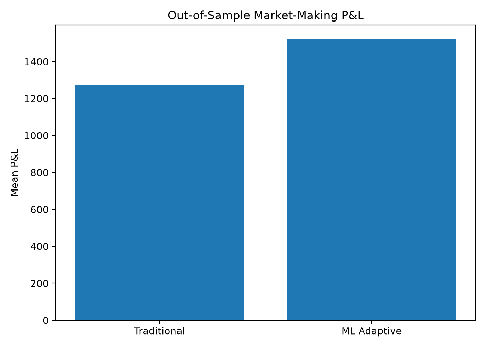
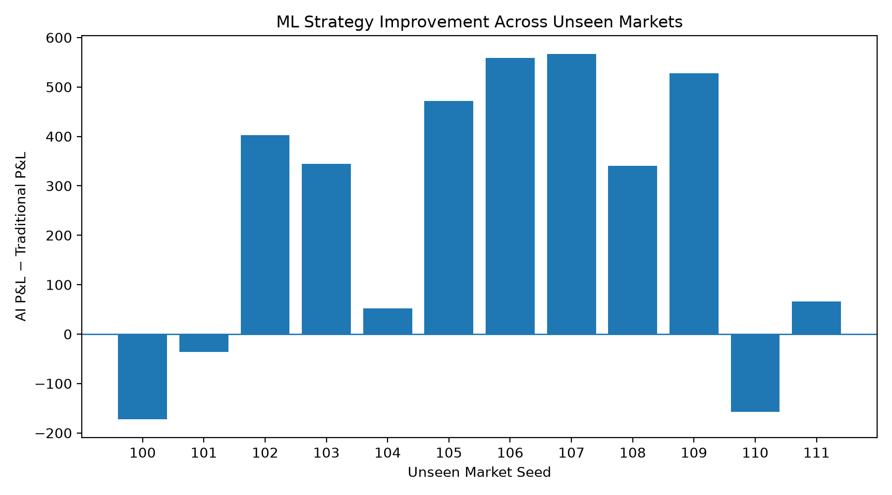
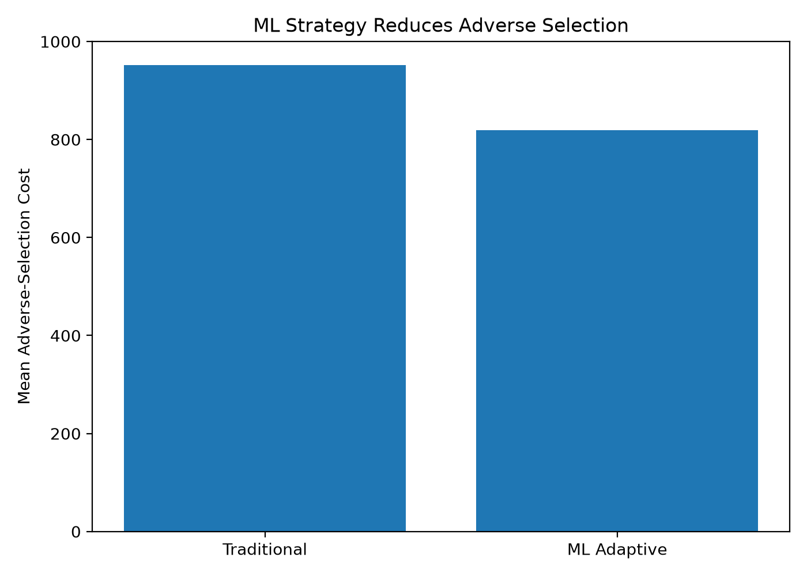
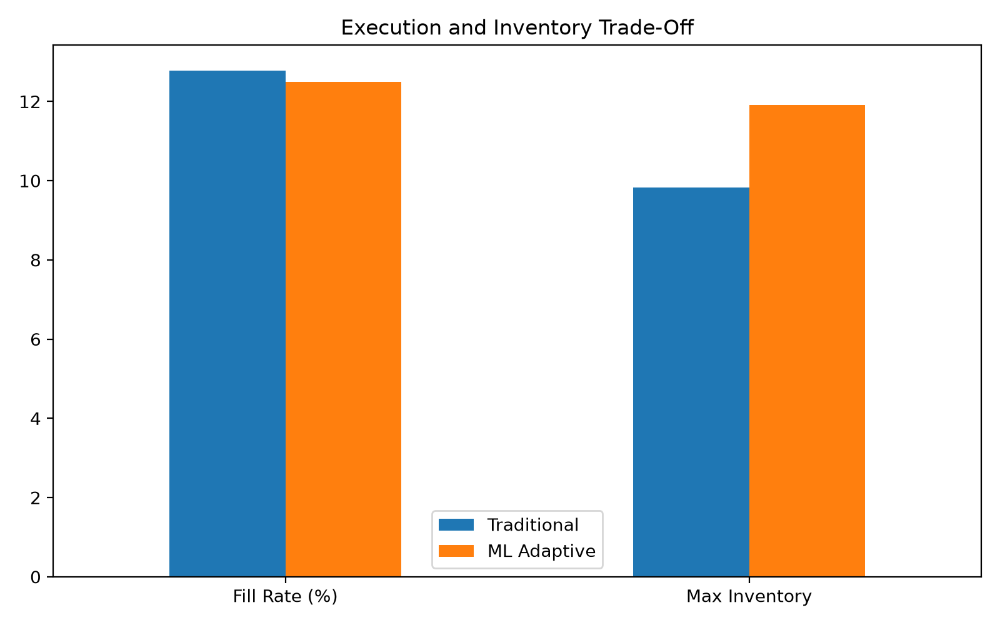

# ML-Adaptive Market Making in a Synthetic Limit Order Book

An agent-based electronic market simulator with a machine-learning market maker that detects hidden informed order flow and adapts its quotes.

The project combines **market microstructure, simulation, supervised machine learning, and out-of-sample strategy evaluation**.

> **Final synthetic benchmark:** the ML-adaptive market maker achieved **19.4% higher mean P&L** and approximately **14% lower adverse-selection cost** than the traditional baseline across 12 unseen simulated markets.

---

## Overview

This project builds an artificial electronic market from scratch.

Noise traders, informed traders, background liquidity, and a market maker interact through a limit order book with price-time priority.

The simulated market contains a hidden information state. During some periods, informed traders receive information that makes buying or selling more attractive.

A machine-learning model observes only information available from market behaviour and estimates whether the market is currently experiencing:

- Normal order flow
- Informed buying
- Informed selling

Those probabilities are then used by an adaptive market maker to modify its quotes.

The ML model **never receives the hidden information state as an input**. The hidden state is used only as a training label and for evaluation.

---

## System Architecture

```text
Synthetic Market
      |
      +-- Noise Traders
      +-- Informed Traders
      +-- Background Liquidity
      |
      v
Limit Order Book
      |
      v
Observable Market Features
      |
      v
Gradient-Boosting Classifier
      |
      +-- P(Normal)
      +-- P(Informed Buy)
      +-- P(Informed Sell)
      |
      v
Directional ML Market Maker
      |
      v
Adaptive Quotes
      |
      v
P&L / Adverse Selection / Inventory

---

## Limit Order Book

The matching engine supports:

- Price-time priority
- Limit and market orders
- Partial fills
- Order cancellation
- FIFO queues at each price level
- Bid/ask spread tracking
- Mid-price calculation
- Multi-level order-book depth

The simulator also contains a hidden fair-value process with stochastic price movements, volatility changes, and persistent information shocks.

---

## Machine Learning

The final ML task is a three-class supervised classification problem:

```text
0 = Normal order flow
1 = Informed buying
2 = Informed selling
```

The model uses observable and lagged market features including:

- Price changes over multiple horizons
- Recent trade counts
- Recent traded volume
- Order-flow imbalance
- Realized volatility
- Bid and ask depth
- Multi-level book imbalance
- Spread
- Market-maker inventory

Only current and historical market information is used, avoiding look-ahead leakage.

Simulation seeds are separated across training, validation, and testing so observations from the same synthetic market do not leak across splits.

Logistic regression and gradient boosting were compared during development. **Gradient boosting** was selected for the final directional model.

---

## ML-Adaptive Market Maker

The traditional market maker reacts mainly to volatility and inventory.

The ML version additionally receives:

```text
P(Normal)
P(Informed Buy)
P(Informed Sell)
```

When informed buying appears more likely, the market maker shifts its reservation price upward.

When informed selling appears more likely, it shifts its reservation price downward.

This allows the strategy to respond to the **direction** of estimated informed flow rather than simply becoming more defensive on both sides.

Strategy parameters were selected using validation simulations before the final held-out benchmark.

---

## Final Out-of-Sample Benchmark

The final evaluation used **12 unseen synthetic markets** that were not used for strategy tuning.

| Metric | Traditional | ML Adaptive |
|---|---:|---:|
| Mean P&L | 1,274.41 | **1,521.47** |
| Mean adverse-selection cost | 952.46 | **819.23** |
| Mean filled quantity | 767.2 | 713.7 |
| Mean fill rate | 12.8% | 12.5% |
| Mean maximum inventory | **9.83** | 11.92 |

### Key Results

- **Mean P&L improvement:** +247.06 (**+19.4%**)
- **ML win rate:** 75%
- **95% confidence interval for mean P&L improvement:** [88.70, 405.42]
- **Adverse-selection reduction:** approximately **14%**

The ML strategy improved P&L and reduced adverse-selection exposure in this benchmark, while taking somewhat greater maximum inventory risk.

These results apply only to the synthetic environment and do **not** imply real-world trading profitability.

---

## Results

### Out-of-Sample P&L



### Performance Across Unseen Markets



### Adverse Selection



### Execution and Inventory Trade-Off



---

## Project Structure

```text
src/lob_sim/
    models.py
    order_book.py
    market.py
    traders.py
    market_maker.py
    simulation.py
    accounting.py
    directional_signal.py
    directional_market_maker.py

scripts/
    build_directional_dataset.py
    train_directional_flow_model.py
    tune_directional_ai.py
    run_final_ai_benchmark.py
    run_experiments.py
    run_single_simulation.py
    make_final_figures.py

tests/
    test_order_book.py
    test_market.py
    test_market_maker.py
    test_simulation.py
    test_accounting.py
```

---

## Testing

The project passes **29 automated tests** covering the order book, market process, market maker, simulation, and accounting system.

```bash
python -m pytest -q
```

---

## Reproducing the Final Benchmark

```bash
python scripts/run_final_ai_benchmark.py
python scripts/make_final_figures.py
```

The final benchmark results are stored in:

```text
results/tables/final_directional_ai_benchmark.csv
```

---

## Limitations

This is a synthetic research environment.

The traders, fair-value process, information regimes, and order flow are simulated. The ML model has not been validated on historical exchange data or live markets.

The reported P&L therefore does **not** imply real-world trading profitability.

The purpose of the project is to explore how machine learning can interact with market microstructure and market-making logic in a controlled environment.

---

## Tech Stack

- Python
- NumPy
- pandas
- scikit-learn
- matplotlib
- SortedContainers
- joblib
- pytest